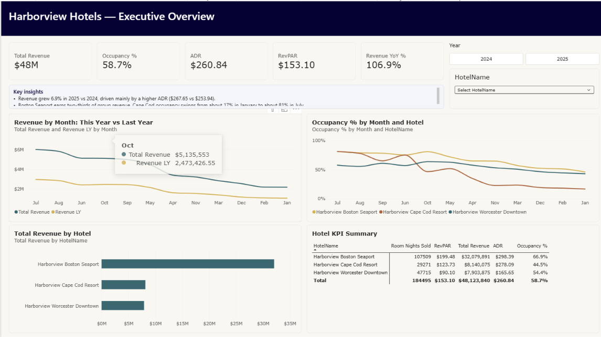
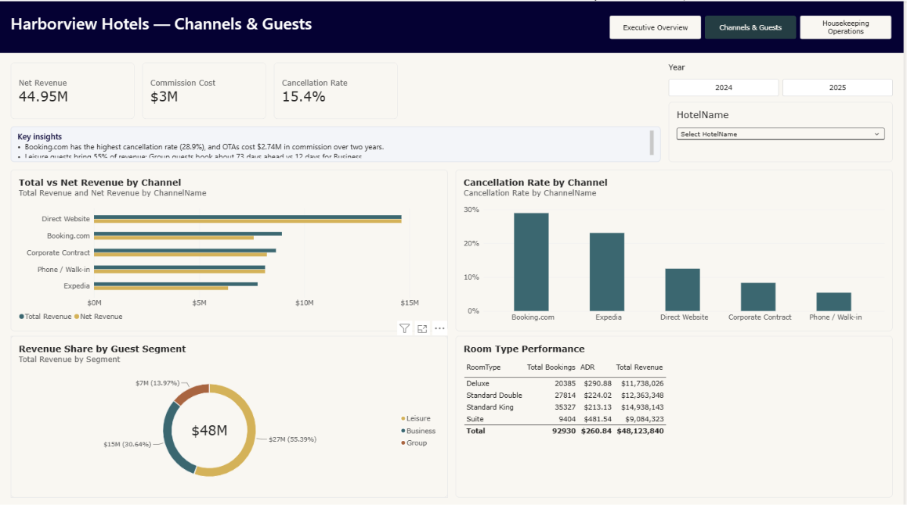
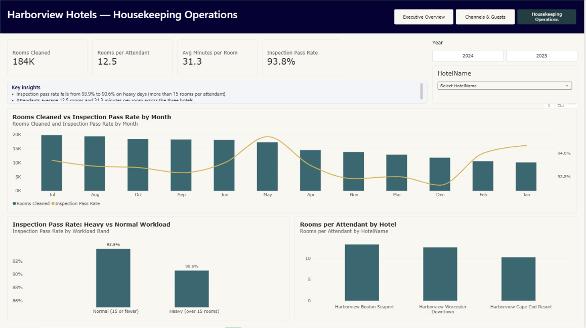

# Hotel Revenue & Operations Dashboard (Power BI)

A 3-page Power BI dashboard that analyses revenue, occupancy, booking channels and housekeeping performance for **Harborview Hotels Group**, a fictional group of 3 hotels in Massachusetts, across 2024–2025.

**Tools:** Power BI Desktop · Power Query · DAX · Excel

📄 [View the dashboard as PDF](Hotel_Revenue_Dashboard.pdf) · 📊 [Download the .pbix](Hotel_Revenue_Dashboard.pbix)

---

## Business questions

1. How are revenue, occupancy, ADR and RevPAR trending, and how do they compare with last year?
2. Which hotels and months drive revenue, and how strong is seasonality?
3. Which booking channels bring the most revenue after commission, and which cancel most?
4. How do guest segments differ in spend and booking lead time?
5. Is housekeeping keeping up, and does a heavier workload affect cleaning quality?

## Dashboard

### 1. Executive Overview


### 2. Channels & Guests


### 3. Housekeeping Operations


## Key findings

- **Revenue grew [6.9]% in 2025**, driven mainly by a higher ADR ([$267.65] vs [$253.94]) while occupancy rose about 1 point.
- **The Cape Cod resort is highly seasonal**: occupancy swings from about [17]% in January to about [81]% in July.
- **Online travel agencies are the most expensive channels.** Booking.com has the highest cancellation rate ([29]%), and OTAs together cost about [$2.7M] in commission.
- **Group guests book about [73] days ahead and Business guests about [12]**, which supports different pricing windows per segment.
- **Inspection pass rates drop from [93.9]% to [90.6]%** on days when attendants clean more than 15 rooms each.

*(Replace the bracketed numbers with the values from your own dashboard.)*

## Data model

Star schema with two fact tables and four dimensions:

- **Facts:** `Bookings` (1 row per booking, ~93K rows), `Housekeeping` (1 row per hotel per day)
- **Dimensions:** `Date` (built in DAX), `Hotels`, `RoomTypes`, `Channels`
- An inactive relationship on `BookingDate` is activated with `USERELATIONSHIP` for booking-date analysis.

## Data preparation (Power Query)

- Removed 25 duplicate booking records
- Standardised 40 inconsistent segment labels (trimmed spaces, fixed capitalisation)
- Set data types and added a `LeadTimeDays` column

## DAX highlights

```DAX
Occupancy % = DIVIDE ( [Room Nights Sold], [Available Room Nights] )

RevPAR = DIVIDE ( [Total Revenue], [Available Room Nights] )

Revenue LY = CALCULATE ( [Total Revenue], SAMEPERIODLASTYEAR ( 'Date'[Date] ) )

Commission Cost =
SUMX ( Bookings, Bookings[RoomRevenue] * RELATED ( Channels[CommissionPct] ) )
```

20 measures in total, covering revenue, hotel KPIs (Occupancy, ADR, RevPAR), time intelligence, channel profitability and housekeeping productivity.

## Assumptions

- The dataset is **synthetic**, generated for this portfolio project to resemble real hotel operations.
- A booking's nights and revenue are counted on its check-in date. Real property management systems split a stay across each night.
- Revenue covers room revenue only. No-shows are charged one night.

## Repository contents

| File | Description |
| --- | --- |
| `Hotel_Revenue_Dashboard.pbix` | Power BI report file |
| `Hotel_Revenue_Dashboard.pdf` | PDF export of all 3 pages |
| `data/Harborview_Hotels_Data.xlsx` | Source data (5 sheets) |
| `images/` | Dashboard screenshots |

## About me

**Shrey Upadhyay**, Data Analyst · M.S. Data Science (University of Essex)
[LinkedIn](https://www.linkedin.com/in/shrey-upadhyay-0435b724b) · [GitHub](https://github.com/ShREy030)
